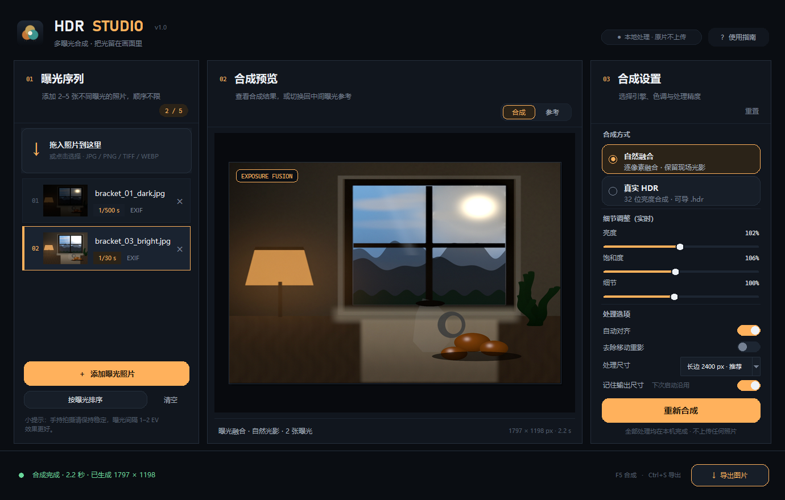
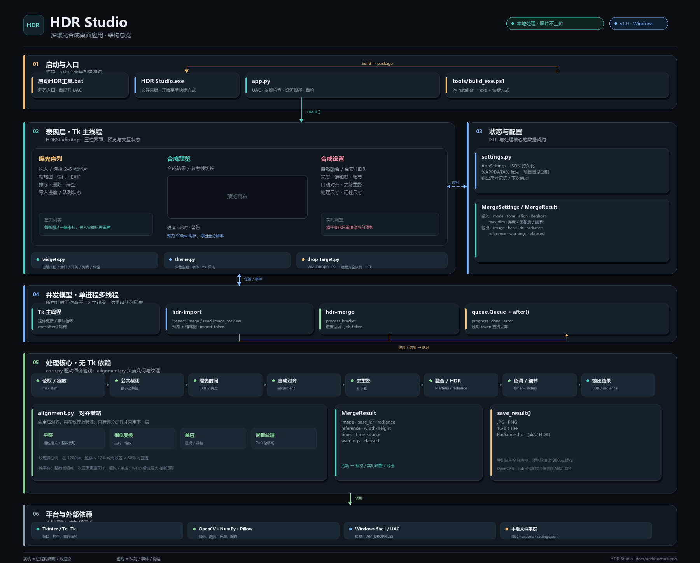

# HDR Studio

> 项目目录：`HDR-Studio/`。代码、虚拟环境、样片、测试和文档都已收进这个文件夹。

一款用 Python + Tkinter 开发的本地图像处理工具：导入 **2–5 张不同曝光的照片**，自动对齐并合成一张高动态范围图像。



## 功能

- **2–5 张曝光合成**：支持 JPG / PNG / TIFF / WEBP，自动裁齐尺寸。
- **拖入导入**：把照片直接拖到左侧虚线区域即可添加；读取在后台完成，导入 5 张 12 MP 照片时界面仍保持响应。
- **两种合成引擎**
  - **自然融合**：Mertens 曝光融合，画面自然锐利，适合大多数场景。
  - **真实 HDR**：在线性域合成 32 位亮度图，支持自然 / 细节 / 柔和三种色调映射，可导出 Radiance `.hdr`。
- **自适应几何对齐**：纯平移时优先整像素裁切，不做插值；亚像素平移做一次 Lanczos 重采样；检测到旋转/轻微缩放时用 ORB + RANSAC 估计，并用高频纹理在相似变换与单应之间自动择优，再小幅裁切；最后用 7×9 相位相关局部位移场修正景深视差。
- **移动重影抑制**（可选，至少 3 张）：检测行人、车辆等局部移动物体，以中间曝光为基准消除重影；默认关闭，避免误伤流云和水面。
- **EXIF 曝光时间**：相机写入的快门时间会自动读取；没有 EXIF 时按画面亮度估算曝光比例。
- **实时预览与细节调整**：可在「合成结果 / 参考图」之间切换；亮度、饱和度、细节滑杆在合成后实时生效，导出时按完整分辨率重新应用。
- **启动时请求管理员权限**：通过 Windows UAC 获取写入受保护目录（如桌面）所需的权限。
- **本地处理**：照片不上传，无网络请求，无第三方云服务。
- **高分辨率导出**：JPG、PNG、16 位 TIFF，以及真实 HDR 模式下的 32 位 `.hdr`。
- **输出尺寸记忆（可开关）**：可在下次启动时沿用上次选择的处理尺寸；关闭后恢复默认长边 2400 px。

## 快速开始

### 免 Python 运行版（已生成）

下载 release中的 hdr-studio-v1_0.zip  解压缩，并确保HDR Studio.exe  和  _internal  处于同一个文件夹下，然后双击HDR Studio.exe  即可运行
### Windows 一键启动（源码版）

双击项目根目录的 **`启动HDR工具.bat`**。

启动时 Windows 会弹出 **UAC 管理员权限提示**，选择“是”后程序才会打开；如果取消，程序将退出。

第一次运行会自动创建 `.venv` 并安装依赖，可能需要 1–3 分钟；以后启动会直接请求 UAC 并打开界面。

> 需要 Python 3.10 或更高版本。如果系统没有 Python，请先从
> [python.org](https://www.python.org/downloads/) 安装，并勾选 “Add Python to PATH”。

依赖只有 NumPy、Pillow 和 OpenCV-Python，Tkinter 随 Python 一起安装。

## 使用步骤

1. 点击 **添加曝光照片**，或把 2–5 张同一场景、不同快门的照片拖到左侧的「拖入照片到这里」区域。顺序不限。
2. 检查左侧序列；可用 **按曝光排序** 按快门或亮度排列，也可点选后用 `Delete` 移除。
3. 选择合成方式：
   - 日常风景、室内外混合：推荐 **自然融合**；
   - 需要 32 位亮度数据或更强的高光/阴影控制：选 **真实 HDR**，再选择色调风格。
4. 合成后拖动亮度、饱和度、细节滑杆，预览会实时更新；选择处理尺寸。配置区底部有「记住输出尺寸」开关。
5. 点击 **开始合成**，等待进度完成。切换「参考」可查看中间曝光原图。
6. 点击 **导出图片**。默认打开项目的 `exports/` 目录；如果目标位置不可写，会自动改存到 `exports/`。真实 HDR 模式额外提供 `.hdr`。

界面快捷键：`Ctrl+O` 添加照片，`F5` 合成，`Ctrl+S` 导出，`Delete` 移除选中，`F1` 使用指南。

## 拍摄建议

- 最少 2 张就能合成；3–5 张通常能获得更完整的动态范围。
- 使用三脚架或保持身体稳定；如果手持，开启「自动对齐」。纯平移时只裁边，亚像素时一次重采样；检测到旋转/缩放时会按纹理选择相似变换或单应，再小幅裁切，并修正局部景深视差。
- 只改变快门速度，不改变光圈、ISO、对焦和白平衡。
- 曝光间隔建议 1–2 EV。例如 `1/500s`、`1/125s`、`1/30s`。
- 确保最暗的一张保留窗外/灯牌高光，最亮的一张保留室内暗部。
- 有风时云和水面会变化；此时建议关闭「去除移动重影」，避免把云层替换成中间曝光的暗块。

## 合成原理

```
读取照片 → 统一尺寸 → 读取/估算曝光时间 → 自动对齐
        → 可选重影检测 → 曝光融合 或 32 位线性域合并
        → 色调映射 → 亮度/饱和度/细节调整 → 导出
```

- **自然融合**：OpenCV `MergeMertens`，使用对比度、饱和度和曝光良好度权重，直接生成显示用 8 位结果。
- **真实 HDR**：先将 sRGB 图像线性化，以 `radiance = linear / exposure_time` 做加权合并，再用 Reinhard 色调映射压缩到显示器范围。权重会避开过曝和死黑像素。
- **对齐**：先分析运动类型。纯平移时在梯度幅值图上做相位相关：整数位移直接裁切、不插值，亚像素位移做一次 Lanczos 对齐；如果检测到旋转或缩放，则用 ORB 特征 + RANSAC 估计相似变换，同时估计单应候选，用高频纹理相关性择优，取公共有效区域裁切，避免黑边；最后在 1200px 工作图上用 7×9 相位相关网格修正景深视差。
- **重影抑制**：在低分辨率下比较归一化亮度与中值亮度的偏差，剔除大面积的云层变化，只对局部移动物体生成羽化遮罩。

## 对齐验证集

使用 `照片对齐训练用例/` 里的 5 张 4000×3000 DJI Mimo AEB 照片做了几何对齐验证。该序列并不是单纯平移：各帧之间存在约 **0.36°–0.73° 旋转** 和 **约 0.2%–0.3% 缩放漂移**，只用平移裁切会让边缘相关性明显下降。

| 方案 | 边缘相关性（越高越好） |
|---|---:|
| 仅平移裁切（旧 1600px 验证） | 0.492 |
| 仅相似变换（2400px） | 0.747 |
| 全局几何 + 局部纹理修正（2400px） | **0.920** |

- 对齐后从 2400×1800 裁为 2357×1746，保留约 95% 画面面积。
- `xin` 严重偏移序列（2400px）：全局对齐平均 0.745，加局部修正后 **0.861**；第 5 帧从 0.550 提升到 0.758。详见 [docs/xin_report.md](docs/xin_report.md)。
- 复现：`python tools/alignment_benchmark.py`、`python tools/xin_compare.py`
- 完整合成复现：`python tools/dataset_smoke.py`（输出 `docs/alignment_final.jpg`）
- 完整报告：[docs/alignment_report.md](docs/alignment_report.md)
- 对比图：[docs/alignment_compare.jpg](docs/alignment_compare.jpg)

这类对齐任务不需要神经网络训练；关键是选择合适的几何模型。该数据集表明“纯裁切”不足以处理真实手持/运动相机素材，所以算法会自动在“裁切”“相似变换+裁切”和“单应+裁切”之间选择，并且只有纹理评分确实提升时才启用更复杂的模型；全局几何确定后再用局部网格修正景深视差。

## 输出尺寸记忆

- 打开「记住输出尺寸」后，每次修改「处理尺寸」都会立即保存；下次启动自动恢复。
- 关闭后，下次启动恢复默认「长边 2400 px」；本次运行仍保留当前选择。
- 只记忆尺寸，不记忆亮度、饱和度、合成模式等其他参数。
- 配置文件位置：
  - Windows：`%APPDATA%\HDRStudio\settings.json`
  - macOS：`~/Library/Application Support/HDRStudio/settings.json`
  - Linux：`${XDG_CONFIG_HOME:-~/.config}/HDRStudio/settings.json`
- 如果系统配置目录不可写（例如被沙箱或权限策略拦截），源码版会改存到项目根目录的 `hdrstudio_settings.json`；exe 版会改存到 `HDR Studio\hdrstudio_settings.json`。
- 可通过环境变量 `HDRSTUDIO_CONFIG` 指定其他配置文件路径。

## 架构



分为启动/入口、Tkinter 表现层、状态与配置、后台任务、OpenCV 处理核心和平台依赖六层；`core.py` 不依赖 GUI，导入与合成都在工作线程执行，结果经队列回主线程。完整的组件图、数据流和并发模型见 [docs/architecture.md](docs/architecture.md)。

## 项目结构

```
.
├─ app.py                     # 启动入口（含依赖检查）
├─ HDR Studio/
│  ├─ HDR Studio.exe          # 免 Python 运行版
│  └─ _internal/              # 打包后的运行依赖，必须和 exe 放在一起
├─ hdrstudio/
│  ├─ core.py                 # 图像读取、重影、融合、色调映射、导出
│  ├─ alignment.py            # 平移/亚像素裁切、相似/单应、局部视差修正
│  ├─ drop_target.py          # Windows 原生文件拖入
│  ├─ settings.py             # 输出尺寸记忆配置
│  ├─ gui.py                  # Tkinter 界面与交互
│  ├─ widgets.py              # 自绘按钮、滑杆、卡片、对话框等
│  └─ theme.py                # 配色、字体、ttk 样式
├─ exports/                   # 默认导出目录（运行后创建）
├─ assets/                    # 图标与空状态插画
├─ samples/                   # 3 张程序生成的曝光示例
├─ tools/
│  ├─ build_exe.ps1           # 生成 exe 并创建开始菜单快捷方式
│  ├─ draw_architecture.py    # 重新生成 docs/architecture.png
│  └─ ...                     # 示例图片 / 素材生成 / 对齐验证脚本
├─ 照片对齐训练用例/           # 真实 AEB 对齐验证样片（用户数据）
├─ tests/test_core.py         # 核心算法单元测试
├─ docs/                      # 架构图、界面截图、对齐验证报告
├─ requirements.txt
└─ 启动HDR工具.bat
```

## 示例照片

`samples/` 中有三张程序生成的曝光片（`1/500s`、`1/125s`、`1/30s`），带有正确 EXIF，适合快速体验：

1. 点击「添加曝光照片」；
2. 选择 `samples/bracket_01_dark.jpg`、`bracket_02_mid.jpg`、`bracket_03_bright.jpg`；
3. 直接点「开始合成」。也可以只选其中任意 2 张，体验 2 张合成。

示例图由 `tools/generate_samples.py` 用纯数学生成，不包含第三方照片。

## 测试

```bash
python -m unittest discover -s tests -v
```

测试覆盖曝光读取、2 张/多张合成、平移/亚像素裁切对齐、相似变换与单应纹理对齐、实时细节调整、尺寸记忆读写、文件拖入、尺寸/数值合法性、错误参数以及 JPG/PNG/TIFF/HDR 导出。

## 说明与限制

- 处理尺寸「原始尺寸」会按原图像素运行，照片很大时更占内存和时间；建议先用长边 2400 px 试效果。
- 暂不支持 RAW、HDR 输入文件或 16 位输入的高精度保留；输入会统一转成 8 位 RGB 参与合成。
- `.hdr` 仅在「真实 HDR」模式下可导出；自然融合结果是显示用 8 位图。
- 自动对齐可以处理平移、小幅旋转/缩放和一定程度的透视/视差；局部网格能减轻景深视差，但强烈镜头畸变、明显前景遮挡或大视差仍建议使用三脚架。
- 自动重影抑制是保守策略，默认关闭。大面积移动（云、水、树叶）不建议开启。
- 界面主要针对 Windows 10/11 优化；Tkinter 的跨平台能力也让它在 macOS/Linux 上可运行。
- Windows 下每次启动都会请求管理员权限；UAC 提示由 Windows 生成，取消后程序不会运行。
- 管理员模式下 Windows 默认会阻止资源管理器拖入；程序通过原生 `WM_DROPFILES` 和窗口消息过滤启用拖放。若系统策略仍拦截，请使用「添加曝光照片」按钮。
- 管理员权限主要用于写入桌面等受保护位置；即使没有写入权限，仍可使用项目内的 `exports/` 目录。
- 管理员权限会扩大程序对系统的访问范围，请只运行本项目目录中的可信代码。
- 如果启动失败，源码版在项目根目录、exe 版在 `HDR Studio\` 下生成 `hdrstudio_error.log`，可据此排查依赖或环境问题。
