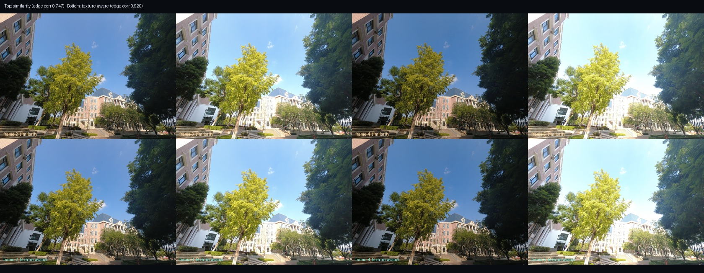
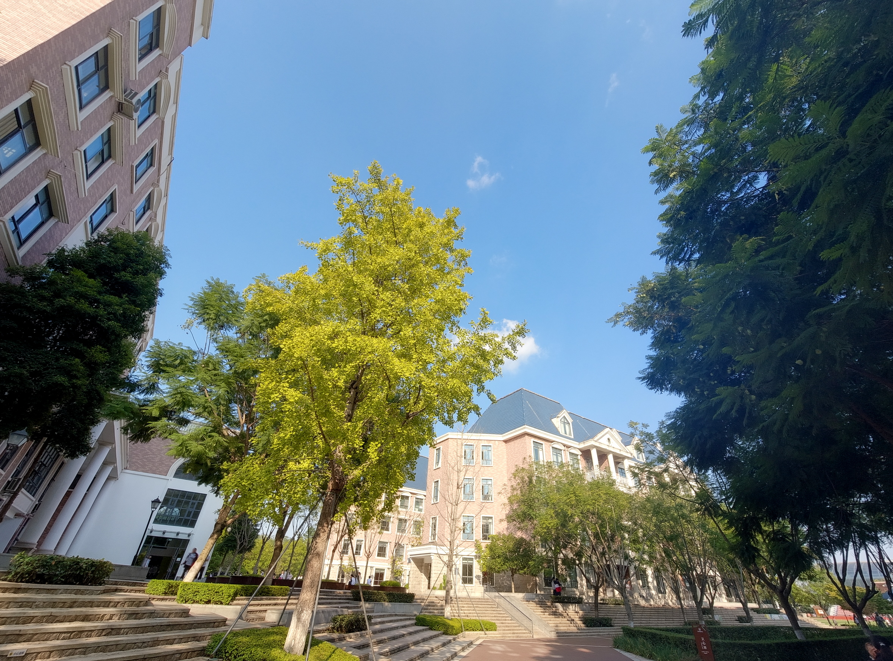

# 自动对齐验证报告

数据：`照片对齐训练用例/`，5 张 4000×3000 的 DJI Mimo AEB 照片。
验证分辨率：长边 2400px；参考帧：第 1 张（按曝光中位数）。

## 结论

- 仅相似变换（ORB + RANSAC）：边缘相关系数均值 **0.747**。
- 全局几何 + 局部纹理修正（相似变换 / 单应择优后修正视差）：**0.920**。
- 输出尺寸：2357×1746，保留约 95.3% 画面面积。
- 耗时：相似变换 2.34s；全局+局部完整对齐 4.31s。
- 本次选中单应：是；平均平移量 4.37px。

## 每帧参数

| 帧 | 曝光(s) | 旋转(°) | 缩放 | 平移(px) | 相似变换相关性 | 全局+局部相关性 |
|---:|---:|---:|---:|---:|---:|---:|
| 1 | 0.00200 | +0.000 | 0.00000 | (+0.00, +0.00) | 1.000 | 1.000 |
| 2 | 0.00125 | +0.403 | 0.99774 | (+9.14, -7.39) | 0.784 | 0.955 |
| 3 | 0.00250 | +0.533 | 0.99713 | (+9.24, -14.73) | 0.724 | 0.936 |
| 4 | 0.00080 | +0.644 | 0.99767 | (+11.58, -16.35) | 0.748 | 0.913 |
| 5 | 0.00250 | +0.744 | 0.99768 | (+14.15, -17.92) | 0.733 | 0.878 |

> 相关性使用 Scharr 梯度幅值计算，范围约 0–1；越高表示边缘越一致。
> 相似变换的 4 参数模型无法消除不同景深处的视差；单应候选只有在
> 高频纹理相关性明显优于相似变换时才会被采用，否则自动回退。
> 全局几何确定后，再用 7×9 相位相关局部位移场修正景深视差；只有纹理
> 评分确实提升时才追加一次小位移 remap。整数平移仍保持无损裁切。

