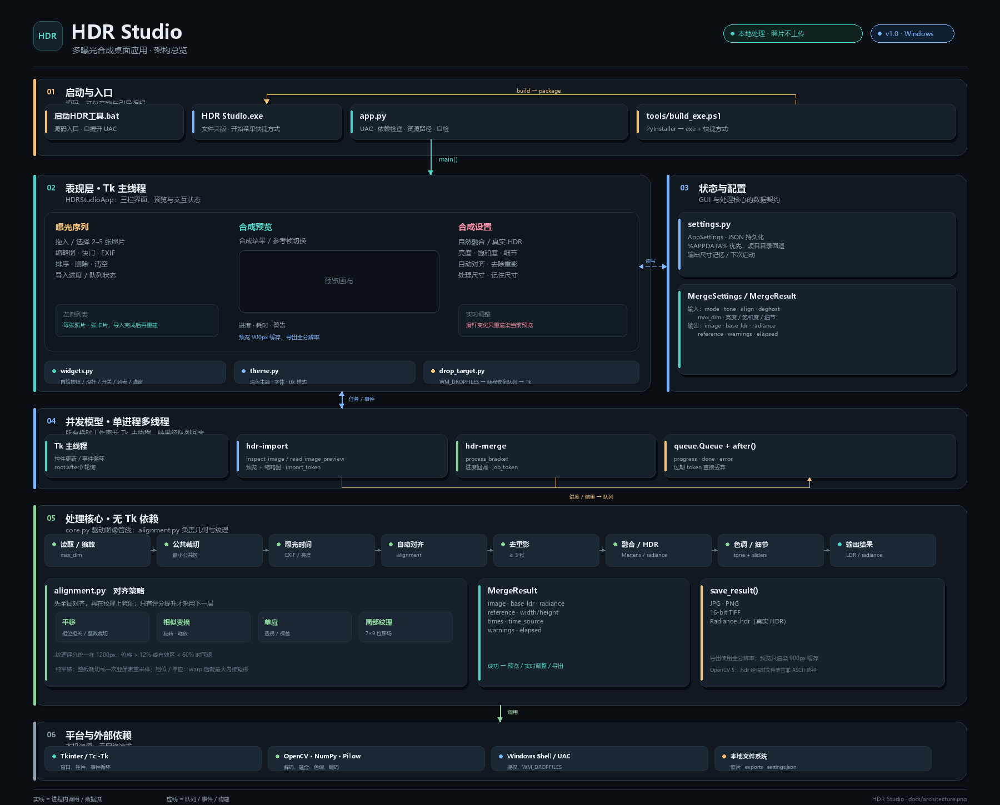
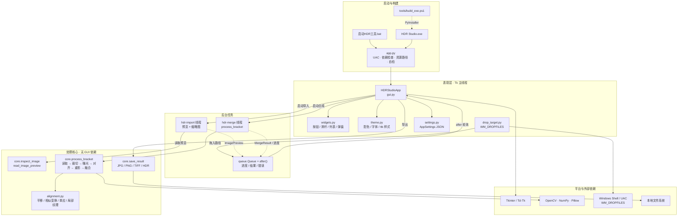

# HDR Studio 架构

HDR Studio 是一个本地运行的 Windows 桌面应用：Tkinter 负责界面与交互，OpenCV / NumPy / Pillow 负责图像处理。程序按“入口 → 表现层 → 后台任务 → 处理核心 → 平台依赖”分层，状态与配置作为 GUI 的旁路数据契约；处理核心不依赖 GUI，可以单独测试和复用。



## 组件图



## 分层职责

| 层 | 主要文件 | 职责 |
|---|---|---|
| 启动与构建 | `app.py`、`启动HDR工具.bat`、`tools/build_exe.ps1` | 管理员权限、依赖检查、资源路径、打包与开始菜单快捷方式 |
| 表现层 | `hdrstudio/gui.py` | 三栏界面、曝光序列、预览、参数、进度、导出 |
| 自绘控件 | `hdrstudio/widgets.py` | 圆角按钮、滑杆、开关、分段控件、列表卡片、弹窗 |
| 视觉样式 | `hdrstudio/theme.py` | 深色主题、颜色混合、字体、ttk 样式 |
| 拖放接入 | `hdrstudio/drop_target.py` | 原生 `WM_DROPFILES`，只把路径放入线程安全队列 |
| 配置 | `hdrstudio/settings.py` | `AppSettings` 的 JSON 读写、用户目录失败时回退项目目录 |
| 后台任务 | `hdrstudio/gui.py` | `hdr-import` / `hdr-merge` 线程，`queue.Queue` 与 `after()` 回主线程 |
| 处理核心 | `hdrstudio/core.py` | 读取、公共裁切、曝光估计、重影检测、融合/HDR、色调映射、导出 |
| 对齐 | `hdrstudio/alignment.py` | 相位相关平移、相似变换、单应、纹理评分、局部视差修正 |

## 核心数据流

1. **导入**：`HDRStudioApp._add_file_paths()` 先做扩展名/数量校验，再启动 `hdr-import`；工作线程调用 `inspect_image()` / `read_image_preview()`，只做一次解码，得到 `ImagePreview`。
2. **回主线程**：导入线程把结果放入 `queue.Queue`；Tk 主线程通过 `root.after()` 轮询，更新列表和缩略图，避免在 UI 线程做磁盘解码。
3. **合成**：`_start_merge()` 生成 `MergeSettings` 和新的 `job_token`，启动 `hdr-merge`；工作线程调用 `process_bracket(paths, settings, progress)`。
4. **处理管线**：`读取/缩放 → 公共裁切 → EXIF/亮度曝光 → 参考帧选择 → 自动对齐 → 可选去重影 → MergeMertens 或 32 位 radiance 合并 → 色调映射 → 亮度/饱和度/细节`。
5. **回传与预览**：`MergeResult` 含结果图、`base_ldr`、`radiance`、参考帧、警告；主线程恢复按钮状态，滑杆只对 900px 预览缓存调用 `render_adjustments()`。
6. **导出**：`_save_image()` 使用全分辨率 `MergeResult` 调用 `save_result()`；JPG/PNG 走 Pillow，TIFF/HDR 走 OpenCV（HDR 使用临时文件兼容 OpenCV 5 与非 ASCII 路径）。

## 并发与一致性

- **Tk 主线程**只操作控件，不执行图片解码或合成。
- `hdr-import` 线程负责导入；`_import_token` 防止旧的导入任务覆盖新列表。
- `hdr-merge` 线程负责合成；`_job_token` 丢弃过期任务的结果，`_queue` 传递 `progress / done / error`。
- `drop_target.py` 的窗口过程不直接调用 Tk，只把路径放入 `queue.SimpleQueue`，由 Tk 的 `after` 泵排空，避免跨线程重入。
- 关闭窗口时取消 `after` 定时器并停止轮询；后台线程为 daemon，不阻塞退出。

## 依赖方向

```text
app.py
  └─ hdrstudio.gui
       ├─ hdrstudio.core ──► hdrstudio.alignment
       ├─ hdrstudio.widgets ──► hdrstudio.theme
       ├─ hdrstudio.settings
       └─ hdrstudio.drop_target

hdrstudio.core 不导入 gui；alignment 不依赖 GUI。
```

启动顺序与路径：

```text
双击 .bat / .exe / python app.py
  → UAC 提权（非自检模式）
  → 检查 cv2 / Pillow
  → 加入 .vendor（源码版存在时）
  → hdrstudio.gui.main()
```

## 构建与测试

```powershell
# 源码运行
.venv\Scripts\python.exe app.py

# 测试
.venv\Scripts\python.exe -m unittest discover -s tests -v

# 生成文件夹版 exe + 开始菜单快捷方式
powershell -ExecutionPolicy Bypass -File tools\build_exe.ps1
```

打包产物是 `HDR Studio\HDR Studio.exe` + `_internal\`，不是单文件；`_internal\` 必须与 exe 一起保留。
