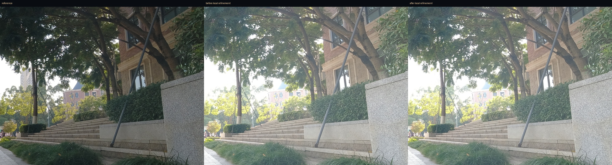

# xin 严重偏移序列对齐报告

数据：`照片对齐训练用例/xin/`，5 张 4000×3000 DJI Mimo AEB，无 EXIF 曝光信息。
验证分辨率：长边 2400px；参考帧：第 1 张（按画面亮度估算曝光后选中）。

## 问题

这组照片的帧间偏移比普通手持序列更大：第 5 帧相对第 1 帧的全局平移约 10.1px
（2400px 输入），同时存在约 0.1° 旋转和轻微缩放。更关键的是，近处路面、右侧
台阶/石墙与远处树木不在同一景深，全局相似变换或单应仍会在前景留下约 3–5px
的局部残差，放大后表现为纹理发虚/重影。

下表为中央 80% 区域的 Scharr 边缘相关性，越高表示边缘越一致：

| 帧 | 仅全局相似变换 | 全局 + 局部纹理修正 |
|---:|---:|---:|
| 2 | 0.799 | **0.927** |
| 3 | 0.840 | **0.895** |
| 4 | 0.790 | **0.865** |
| 5 | 0.550 | **0.758** |
| 平均 | 0.745 | **0.861** |

## 方法

1. ORB + RANSAC 估计全局相似变换和单应候选，按高频纹理评分择优。
2. 在 1200px 工作图上，用 7×9 的相位相关网格估计残余位移场。
3. 只保留响应足够高的网格，平滑并限制最大位移，再用一次 Lanczos remap 修正
   景深视差；修正后纹理评分没有提升的帧会保持原样。
4. 统一裁切公共有效区域，输出 2379×1766。

局部修正只在前景/远景差异明显时追加一次小位移重采样；纯整数平移仍保持
无损裁切，不会为了局部修正破坏这条路径。

## 结果

- 5 张完整合成约 11.2s（自然融合，长边 2400px，未开启去重影）。
- 逐帧边缘相关性从平均 **0.745** 提升到 **0.861**，第 5 帧从 **0.550** 提升到 **0.758**。
- 最终合成：[xin_final.jpg](xin_final.jpg)
- 局部修正前后裁切对比：[xin_crop_before_after.jpg](xin_crop_before_after.jpg)
- 全局对齐后的第 5 帧：[xin_before.jpg](xin_before.jpg)
- 局部修正后的第 5 帧：[xin_after.jpg](xin_after.jpg)



## 复现

```bash
python tools/xin_compare.py
python tools/xin_pipeline.py
```

说明：这组素材前景纹理很强，但第 4/5 帧本身较暗、边缘不如参考帧锐利，
局部修正能拉回几何位置，不能完全恢复已经损失的高频细节。强烈前景遮挡或
运动模糊仍建议使用三脚架/更短曝光。
